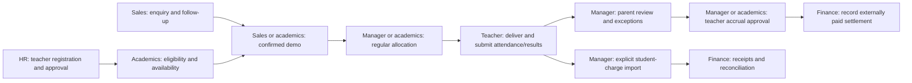

# ClapsLearn ERP — user guide and role journeys

Verified against the current application code on **26 October 2026**. The configured site address is **https://erp.clapslearn.in**. This guide describes implemented routes and permissions; it does not confirm that every local change is deployed. The new Sheets bridge remains disabled until its activation steps are completed.

Use this guide for training and daily work. The [complete route reference](ERP_ROUTE_REFERENCE.md) contains the registered routes, action names and export types. The [Sheets transition guide](sheets-transition.md) covers operator setup and cutover.

## 1. First login

1. Obtain an active account from the site administrator. Public self-registration is disabled.
2. Site administrators use [Superadmin login](https://erp.clapslearn.in/superadmin/login). Other staff, including teachers, use [Staff login](https://erp.clapslearn.in/staff/login). [General login](https://erp.clapslearn.in/login) is also registered. An administrator account is intentionally rejected by the staff-specific login form, and an ordinary staff account cannot use the superadmin form.
3. Sign in using your email and password. If two-factor authentication is enabled, complete the authenticator challenge.
4. Staff choose their business unit from the home page. A linked teacher is redirected to their personal teacher workspace.
5. Open [Account security](https://erp.clapslearn.in/account/security) to manage two-factor authentication. Contact the administrator for account resets or missing access.

Your account and your team role are separate. An account can belong to multiple teams with a different role in each. A teacher also needs an explicit link between their login account and their teacher record.

**About route placeholders:** `{unit}` is the ERP team's numeric database ID, not the text `AA` or `BB`. `{student}`, `{entry}` and other placeholders are record IDs. Choose records through the UI and use the links it generates. Never paste braces into a browser or assume a team ID from its name.

## 2. Choose the correct operating mode

| Mode | Where staff make operational changes | What the ERP displays |
|---|---|---|
| Normal application operation | ERP forms, according to role | Canonical ERP students, lessons, attendance, payments and tasks |
| Sheets transition, once activated | Original Google Sheets | Validated copies under **From Sheets**, with refresh status |

When **Sheets are the temporary source of truth** appears in the banner, ERP operational saves are blocked. This includes teacher attendance/results, sales changes, class allocation, payments and task completion. Login, account administration and supported report reads remain available. The normal workflow pages still display canonical ERP records; they do not automatically switch their backing data to Sheets.

The bridge reads student registration, teacher registration, class hours, reported balances and the weekly timetable. It does not create operational lessons, approve attendance, issue receipts or post financial entries. Sales/HR lifecycle and task synchronization are not included. A Sheet balance is not a reconciled ERP ledger balance, and a weekly Sheet slot is not a dated ERP lesson.

**Daily transition journey:** sign in → open **From Sheets** → select your team and permitted source → check last successful refresh and latest attempt → find the record → update the original Sheet if needed → check the next successful refresh. The target refresh interval is 15 minutes; failed validation preserves the previous copy, so do not assume every edit will appear at the next interval. An older-than-target warning appears after 60 minutes.

| Role | Available Sheet copies |
|---|---|
| Site administrator / team manager / read-only | Students, teachers, class hours, balances, timetable; team access still applies to ordinary team roles |
| Academics | Students, teachers, class hours, timetable |
| Finance | Reported balances |
| Sales/follow-ups | None under the current bridge permission mapping |
| Teacher | No teacher-specific Sheet snapshot portal; personal ERP pages continue to use canonical records |

Only site administrators can inspect **Latest refresh review (all teams)**. They review the reason, correct the original source or arrange an approved identity reconciliation, and have the operator refresh again. Staff do not approve quarantined records by editing the copied values.

## 3. User types and permissions

The five selectable staff team roles are `team_manager`, `academics`, `finance`, `sales_followups`, and `read_only`. Site administrator access and teacher membership are additional access types.

| User type | Main responsibility | Normal starting screen | Important boundary |
|---|---|---|---|
| Site administrator / superadmin | Teams, accounts, permissions, migration, audit and all workflows | `/` or `/erp/administration` | Organization-wide authority; use for administration and escalation |
| Team manager | Coordinate delivery, sales, finance, recruitment and follow-up | Team **Overview** | Cannot administer site accounts or open **Team access** unless also a site administrator |
| Academics / attendance | Matching, teaching eligibility, class planning, attendance and results | Team **Academics** | No Money workspace or private parent-review/HR workspace |
| Finance | Collections, payment requests, receipts and recorded settlements | Team **Money & receipts** | No admissions, academic or private HR workspace |
| Sales / follow-ups | Enquiries, demos, conversion, reminders and student follow-up | Team **Admissions & CRM** | Lead ownership restrictions; no regular class allocation or Money workspace |
| Read-only | Review and permitted exports across team workspaces | Team **Overview** | No mutations, including completion of own tasks; no private tuition/HR workspace |
| Teacher | Own lessons, assigned students, attendance and results | `/teacher` → `/erp/teacher` | Requires active linked identity and matching teacher membership; cannot browse other teachers' records |

**HR is a business function, not a dedicated restricted role yet.** Recruitment management currently requires a team manager or site administrator. Giving someone team-manager access also gives them broader operational access, including money workflows. Do not describe this as HR-only access.

**Read-only is broad viewing access.** It includes the team's Money workspace and full student profiles, plus supported exports. It is not a privacy-limited public viewer role.

**Shared recruitment directory:** the registered/approved teacher directory is shared across the organization. Academics, sales and read-only users can browse that directory; application decisions and private review history are restricted to recruitment managers. Finance does not have this directory page.

## 4. Main screen routes

All routes below are browser GET routes. Prefix them with the configured site address. In the team-screen rows, `B` means `/erp/units/{unit}/business`.

| Screen | Route | Who uses it |
|---|---|---|
| Business units | `/` | Administrator and staff with team access |
| Teams & accounts | `/erp/administration` | Site administrator |
| Operations & audit | `/erp/administration/operations` | Site administrator |
| Overview | `B/dashboard` | Administrator, manager, read-only |
| Admissions & CRM | `B/admissions` | Administrator, manager, sales, read-only |
| Teacher recruitment | `B/teacher-recruitment` | Administrator/manager manage; academics/sales/read-only browse registered directory |
| Teacher matching | `B/allocation` | Administrator, manager, academics, sales, read-only; actions differ by role |
| Students & teachers | `B/people` | Administrator, manager, academics, read-only |
| Academics | `B/academics` | Administrator, manager, academics, read-only |
| Timetable | `B/timetable` | Administrator, manager, academics, read-only |
| Attendance | `B/attendance` | Administrator, manager, academics, read-only |
| Money & receipts | `B/money` | Administrator, manager, finance, read-only |
| Follow-ups | `B/followups` | Administrator, manager, sales, read-only |
| Team access | `B/staff` | Site administrator |
| Migration & exports | `B/migration` | Administrator, manager, read-only |
| Detailed operations workspace | `/erp/units/{unit}` | Administrator, manager, read-only |
| Full student profile | `/erp/units/{unit}/students/{student}` | Administrator, manager, read-only |
| Class follow-up and HR | `/erp/units/{unit}/tuition` | Administrator and team manager |
| Parent statement preparation | `/erp/units/{unit}/tuition/statement?student_id={student}&month=2026-10` | Administrator and team manager |
| My assigned tasks | `/erp/my-tasks` | Current members viewing their own assignments; read-only members cannot complete |
| Teacher entry | `/teacher` | Linked teachers; eligible staff see setup guidance |
| Teacher dashboard | `/erp/teacher` | Linked teachers |
| From Sheets | `/erp/from-sheets` | Enabled bridge plus the source permissions above |
| Migration Center | `/erp/migration-center` | Site administrator |
| Records & administration | `/tools` | Staff entry page; underlying historical administration tools are restricted |
| Account security | `/account/security` | Signed-in accounts |

For example, if the application shows team ID `17`, Admissions is `/erp/units/17/business/admissions`. The shorter `/erp/units/17/admissions` is not the registered Admissions page. The numbers here are examples, not actual production team IDs.

## 5. Site administrator journey

**Outcome:** the right people can work in the right teams, with operational health and ownership visible.

1. Sign in through Superadmin login and open **Teams & accounts**.
2. Create or review team code, display name and timezone. A team's timezone cannot be changed after dated lessons exist. Archive unused teams rather than deleting their history.
3. Create staff accounts and assign their initial team role. Share credentials privately. Role changes and teacher linking are available under the team's **Team access** page.
4. For a teacher, create the login account if necessary, ensure the canonical teacher record is active, grant **teacher** membership in its team, then use **Explicitly link teacher to login account**. The teacher must belong to exactly one teacher unit pool. Matching by a person's name or email alone does not create this link.
5. Confirm business setup: student/teacher records, subject eligibility, availability, rates and schedules. Delegate daily work to the relevant roles.
6. Review **Operations & audit** for failed jobs, integration state, migration status and recorded actions. When the bridge is enabled, check stale sources and sources needing attention.
7. Use **Migration Center** for reviewed migration previews and controlled execution. It is not a normal daily data-entry screen. Previewing or viewing application totals does not certify source reconciliation.
8. For a staff departure, suspend the account or revoke access; use the account actions to revoke sessions. Sensitive account actions require the administrator's current password.

**Daily route:** `/superadmin/login` → `/erp/administration/operations` → `/` → selected team's Overview → unresolved exceptions.

## 6. Team manager / admin operations journey

**Outcome:** each student has an owner, a suitable teacher, confirmed classes and reviewed delivery records.

1. Open the team's **Overview** and inspect unfinished tasks and attendance queues.
2. Review new registrations and admissions handoff notes. Resolve identity conflicts before creating another student or teacher record.
3. Open **Teacher matching** for a lead or existing student. Verify eligibility, confirmed availability, timezone and teaching medium. Book or review the demo and record its outcome.
4. After a successful demo, confirm rates and the weekly schedule with both parties. Use regular allocation to create the enrollment, confirmed agreement and dated lessons. Existing students can be allocated without inventing another enquiry.
5. Review delivered attendance. Coordinate parent statements through **Class follow-up and HR**: prepare the month, share through the real communication channel, and record evidence and an explicit objection deadline. Resolve disputes or corrections before approval when required.
6. In the **Attendance** or **Overview** action queues, make the two decisions separately: **Import this class for student charge**, and **Approve attended teacher earnings**. Review duplicate warnings and parent-review status. The current student-charge policy does not automatically block every duplicate candidate; investigate the warning before choosing to import.
7. Hand receipts and actual settlements to finance. Record private class concerns, shortened-class follow-up and next actions in the appropriate workspace.
8. Assign tasks with an owner, due date and checklist. Check completion and overdue work before closing the day.

**Handoff:** sales → manager/academics for delivery; teacher → manager for parent review and exceptions; manager → finance for collections and settlements.

## 7. Sales / counsellor journey

**Outcome:** every enquiry has a recorded next action and a traceable admission handoff.

1. Open **Admissions & CRM**. Start with Today, Overdue and No next action filters.
2. Search for an existing enquiry before creating one. Shared parent phone numbers are possible; explicitly choose a re-enquiry or a separate student. Do not merge siblings because their phone matches.
3. Capture contact details, grade, subject, source, ownership and learning requirements. Record the contact outcome and the next follow-up date.
4. Use **Teacher matching** for the enquiry. Search a proposed date/time, timezone, duration, subject and medium. Sales can book demos and record demo feedback; teacher eligibility, pay and regular allocation belong to manager/academics workflows.
5. Obtain confirmation from both parties through the actual call/WhatsApp channel, then record evidence and book the demo. A saved booking is not an automatically sent message.
6. After the timed demo ends, record **Continue**, **Try another**, or **Awaiting feedback**. A regular handoff from that demo requires Continue for the same teacher and subject.
7. Convert a confirmed admission to the canonical student record and complete handoff notes. Conversion can record an optional initial received payment using a stable receipt reference; if used, tell finance so they do not record it again. Conversion alone does not create a confirmed teaching timetable.
8. Add reminders and follow-up tasks. Review lead activity and demo history by opening the enquiry. Use the sales report within Admissions for the permitted date range and ownership scope.

**Daily route:** `B/admissions?followup=today` → selected enquiry → `B/allocation?lead_id={lead}` → Admissions handoff → `B/followups` or `/erp/my-tasks`.

Sales users see owned/assigned enquiries, including their own unassigned enquiries, rather than an unrestricted team pipeline. Reminders and recorded calls are internal records; automatic messaging is not part of this journey.

## 8. Academics / scheduling journey

**Outcome:** students and teachers have compatible, conflict-checked dated classes and accurate teaching records.

1. Open **Academics** and review active teaching records and results.
2. Check student grade/syllabus and teacher details in **Students & teachers**. Browse the shared registered teacher directory when finding a teacher.
3. In **Teacher matching**, verify the exact subject/grade/syllabus eligibility and medium, then record confirmed teacher availability with evidence. Imported free-text availability is not sufficient by itself.
4. Search the proposed slot. Check teacher-local time, effective dates, exceptions and any outstanding matching requirements. Obtain bilateral confirmation.
5. Book a demo or confirm a regular allocation within your permissions. Regular allocation creates dated lessons through the selected end date; check the resulting **Timetable**.
6. Review changed classes in **Timetable** and send the lesson ID, agreed replacement time and reason to a manager. The current timetable's reschedule, cancel and extra-class links open the manager-only detailed workspace, so an academics user cannot complete those changes through those links even though the backend role permits the actions. A manager performs the change and preserves its history.
7. Review submitted attendance and duplicate flags. Ask the manager to complete private parent review or resolve disputes, then approve eligible attendance from the teacher-approval queue. Escalate corrections that need the restricted detailed workspace.
8. Check results and export permitted academic data. Close your own assigned tasks after their checklists are complete.

**Daily route:** `B/academics` → `B/allocation` → `B/timetable` → `B/attendance`.

The full student-profile and detailed operations URLs are restricted to managers, site administrators and read-only reviewers. Academics should use their dedicated pages; an action appearing in the permission matrix does not make every composite screen available.

## 9. Finance journey

**Outcome:** actual receipts and settlements are recorded once, matched to the correct student or teacher, and remain auditable.

1. Open **Money & receipts**. Review the student collection queue and existing payment requests. Negative student ledger balances indicate amounts due; positive balances indicate credit.
2. Use **Create payment request** to record an amount being requested. Open its printable view and share it through the agreed channel. A request is not evidence of payment.
3. After funds are actually received, choose **Record received student payment**. Confirm the student, INR amount and unique, stable reference. Check whether sales already recorded an initial payment during conversion.
4. Use **Link received payment to request** when the receipt covers a request. Review covered and outstanding amounts. Open the receipt for printing or saving as PDF.
5. For a mistake, use the receipt correction or reversal form with its reason. Do not hide the mistake by creating another ordinary receipt.
6. Review earned amounts, recorded settlements and net payable for a teacher. After an actual external payment, use **Record already-paid teacher settlement**. This records a payment; it does not transfer money.
7. Export ledger/payment-request records where permitted and reconcile with the real payment evidence. Escalate differences to the manager.

**Daily route:** `B/money` → payment request → received payment → allocation → printable receipt → settlement review.

The current finance UI does not expose the Attendance/Overview charge queues, although the backend role permits the import action. Have a manager perform the reviewed charge import through the existing queue. Do not instruct finance users to type POST endpoints into a browser.

## 10. HR / recruitment journey

**Required access today:** site administrator or team manager. There is no separate HR-only role.

1. Open **Teacher recruitment** and search by name, phone or CT code before adding an application.
2. Work through **Applied → Contacted → Selected**. Record qualifications, preferred subjects/levels, syllabuses, medium, availability, contact history and next follow-up.
3. Resolve **Review** records with verified evidence. A shared phone or conflicting CT code must not silently join two people.
4. Record registration separately, then explicitly approve/link the canonical ERP teacher. A registered application is not automatically an approved, schedulable teacher.
5. Hand the approved teacher to academics/manager for verified eligibility, medium and availability. Hand account creation and explicit teacher-login linking to the site administrator.
6. If using **Class follow-up and HR**, record internal interviews, scores, strengths, concerns and decisions there. This screen uses a separate internal candidate/interview record set: a Ready interview decision does not automatically update the shared recruitment application, grant access or approve a teacher.
7. Confirm the teacher can sign in and see the correct assignments before handing over teaching work.

**Daily route:** `B/teacher-recruitment` → candidate/contact review → registration/approval → `B/allocation` preparation → administrator's `B/staff` account linkage.

## 11. Teacher journey

**Prerequisites:** active login, active linked teacher record, teacher membership in the same non-archived team, exactly one teacher unit pool, and canonical assignments/dated lessons.

1. Sign in through Staff login and open `/teacher`. The personal workspace identifies you from your linked login; do not choose another teacher's identity.
2. Open **Timetable** to review your dated lessons, local times, status and student details.
3. Open **Students** for active assignments and the assessment shortcut.
4. After a class finishes, open **Attendance**. Select the eligible lesson and enter actual minutes. If the start time or duration changed, record the reason; actual start-time input uses your teacher timezone. Future teaching cannot be submitted.
5. Submit once and check the confirmation. If attendance already exists with different details, ask an authorized manager for an audited correction rather than creating a second entry. Submission is followed by review; it does not itself charge the student or pay the teacher.
6. Open **Results**. Select your own active assignment, assessment/date, score and maximum. Zero marks are valid; marks cannot exceed the maximum.
7. Open **Reports** and choose the date/student filters. Narrow the range if the visible lesson limit is reached. Use `/erp/my-tasks` for any assigned checklist work.

| Teacher tab | Route |
|---|---|
| Overview | `/erp/teacher?section=overview` |
| Timetable | `/erp/teacher?section=timetable` |
| Students | `/erp/teacher?section=students` |
| Attendance | `/erp/teacher?section=attendance` |
| Results | `/erp/teacher?section=results` |
| Reports | `/erp/teacher?section=reports` |

Reports accept `from=YYYY-MM-DD`, `through=YYYY-MM-DD` and an optional assigned student's numeric `student` ID. The date range is limited to 366 days; the lesson list shows at most 500 entries. Teacher pages omit guardian contacts and financial rates.

During Sheets-authority mode, this portal remains a view of canonical ERP records and its operational submissions are blocked. The bridge does not populate this teacher dashboard with copied Sheet lessons. Continue the agreed Sheet process until the teacher workflow is cut over.

## 12. Read-only reviewer journey

1. Sign in, choose the team and open **Overview**.
2. Review the relevant student, timetable, attendance, admissions or money screen.
3. Use search, filters and permitted exports. Use **Migration & exports** for application totals, understanding that these totals have not automatically been reconciled to Sheets.
4. Record a discrepancy through the organization's agreed process and send its record reference to the responsible manager. Do not attempt to save changes or complete task checklists.

The private parent-review/HR workspace and site account administration remain unavailable to a plain read-only team member.

## 13. Parents, students and task-only staff

**Parents/students:** there is no implemented parent/student self-service login journey in the current route set. Authorized staff prepare the monthly statement, print/save it and share it manually. Parents respond through the agreed channel; staff record acceptance or dispute. The `/tuition/statement` URL is staff-protected, so sharing that URL alone does not give a parent access.

**Assigned-task journey:** open `/erp/my-tasks` → read due work → finish each checklist item → complete the task. The list is restricted to tasks assigned to that login in current, active team memberships. Read-only users cannot complete tasks. Legacy `sales` memberships can use this limited portal, but the new Sales / follow-ups role is `sales_followups` and also enables the CRM pages.

## 14. How work passes between teams

These are distinct records: **enquiry → student → enrollment → recurring agreement → dated lesson → attendance**. Financial records then track explicit student charges, teacher earnings, actual receipts and recorded settlements. A monthly statement, payment request and receipt serve different purposes. Saving any of these does not automatically send a WhatsApp message or move money.

## 15. Common problems

| What you see | What to do |
|---|---|
| “This account cannot access the selected login” | Use Staff login for ordinary staff/teachers and Superadmin login for a site administrator; ask the administrator to check account status |
| No team after sign-in | Ask the site administrator to assign your current account to the correct active team |
| 403 / action unavailable | Check your team and role; teacher identity/linkage and record ownership are checked separately |
| 404 on an ERP screen | Check the route, selected record and deployed module. From Sheets also returns 404 when disabled |
| 409 with the Sheets-authority message | Make the operational change in the original Sheet; staff cannot override the mode |
| Validation error | Correct the highlighted field. Required confirmation, parent review, identity conflicts and duplicate references need resolution, not repeated submission |
| Teacher cannot see a class | Check canonical enrollment, dated lesson, active status, teacher linkage, membership and date filters; a copied weekly Sheet row is insufficient |
| Cannot approve attendance | Check duplicates, parent-review outcome/deadline, disputes and the active teaching record |
| Receipt reference already exists | Find the original receipt; reuse only an identical retry, otherwise use the correction workflow |
| From Sheets has no new data | Check the last successful refresh and latest attempt; ask a site administrator to inspect review/failure status |
| Account access was changed | Sign in again; account-management actions revoke previous database sessions and remembered logins |

Use **Records & administration** for historical reports when needed. Do not use old synchronization buttons as a shortcut to enable the new bridge. The [route reference](ERP_ROUTE_REFERENCE.md) labels the legacy, operational and technical routes separately.

## Verification and known boundaries

Routes were extracted from Laravel's registered route collection without reading application records. Role journeys were cross-checked with route middleware, controller checks, forms and domain services. An unnamed `POST /login` route was found to be blocked by Sheets authority during this review; a narrow login exception and regression test now cover it. The fix is local until deployed.

This is a guide to current implemented behavior, not a declaration of production cutover readiness. Follow the existing architecture review and migration/reconciliation gates before making the application authoritative.
