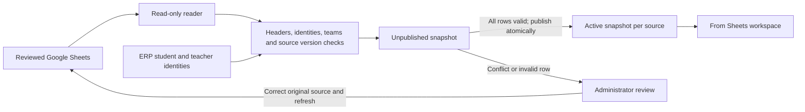
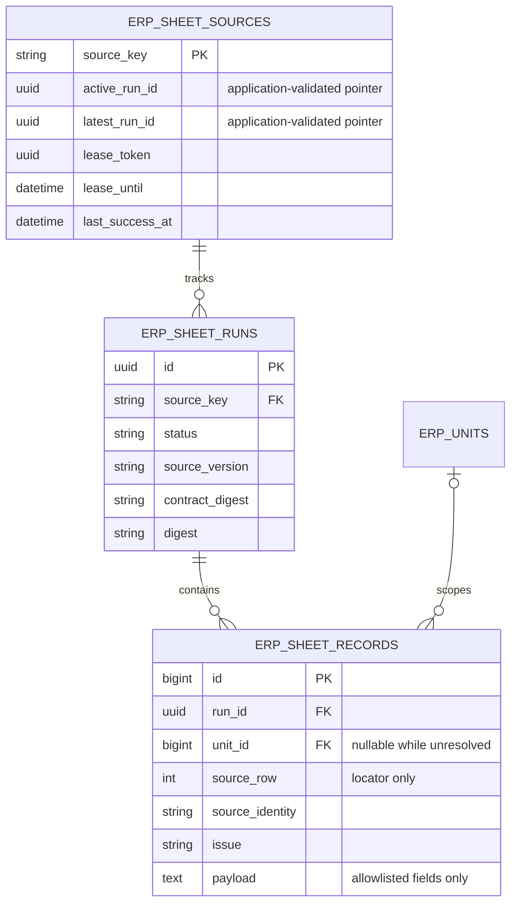

# Running from Sheets during the transition

The ERP now includes a **From Sheets** workspace at `/erp/from-sheets`. It reads five reviewed source tabs into isolated, versioned database snapshots. Staff can consult these copies while continuing to update the original Sheets. This is a transitional read workspace, not an automatic conversion of every Sheet into canonical ERP workflows.

**Implementation is local; the live connection has not been activated.** The default configuration keeps the bridge disabled and leaves existing application behavior unchanged. Production activation still requires the new migration, a dedicated service account with Viewer access, verified source-band/team mappings, successful full-source previews, and a monitored staging rehearsal.

## Coverage

| Source | Available in the bridge | Important boundary |
|---|---|---|
| Student Registration / Form responses 1 | Code, name, band, status, grade, syllabus | Data begins on row 2, not row 3. No addresses, DOBs or contact details retained. |
| HR Teacher 2.0 / Form responses 1 | CT code, name, band, category, status, type, subject | HR registration is the source; VIEW TEACHER is a downstream copy. No banking or identity documents retained. |
| DUPLICATE / DATA | Source record ID, student/teacher codes and labels, date, reported hours | No lesson identity or subject is present. No attendance approval, charge, payroll accrual or duplicate-class adjudication. |
| Master 2025 / DUE | Student identity, status and reported balance | A reported Sheet balance is not a reconciled ERP ledger balance. Precision and negative values are preserved. |
| TT 2025 / TIME TABLE | Student code and seven weekly blocks | Times and teacher labels stay as written. No timezone interpretation, conflict checking or dated lesson creation. |

Live sales/demo lifecycle sync, HR applicant lifecycle sync, task completion, marklists, payment transactions and invoices are **not** covered by this bridge. Existing reviewed import workflows remain separate. These sources require their own stable identities and mappings before automation; invoice templates and derived due views must not be imported again as financial transactions.

## Data path and relationships





The three new tables have database foreign keys for run/source, record/run and record/team. They also have D1 revision triggers. The active/latest pointers are maintained by the service transaction. Student and teacher codes are logical links validated against existing ERP identities and published registration snapshots; they are not foreign keys to canonical people. New people can therefore be viewed before their formal ERP migration.

## Controls implemented

- A separate `ERP_SHEETS_TRANSITION_ENABLED` flag; no reliance on the legacy `SHEETS_SYNC_ENABLED` integration.
- Read-only Sheets and Drive metadata OAuth scopes. No source writes, outbound notifications or accounting effects.
- Source tab IDs, header sentinels, bounded pages, complete grid scanning, quota pacing and bounded transient retries. Empty intermediate pages do not terminate the scan. Oversized grids fail instead of truncating silently.
- Resource guards reject grids above 100,000 rows, more than 25,000 populated rows, cumulative read payloads above 8 MiB, or individual HTTP responses above 4 MiB. Limits fail the whole refresh; larger sources need an operator-reviewed partitioning or capacity change.
- Drive version checked before and after a source read. Changes to identity dependencies during refresh also reject publication. This detects edits, but does not turn cross-workbook formulas or IMPORTRANGE recalculation into an atomic Google snapshot. The source records remain reported observations.
- Every row must pass before publication. Duplicate IDs quarantine all occurrences. Unknown bands, invalid values, name/team conflicts and unknown referenced people require review. Missing balances are never converted to zero.
- Unchanged contents reuse the existing snapshot. A disappeared source identity requires the exact preview digest to be approved explicitly. Empty snapshots cannot replace a valid copy.
- Database leases and conditional publication prevent overlapping or abandoned workers from publishing. Staged writes use bounded batches; a failed batch leaves the previous active pointer intact.
- Team and page permissions apply to published rows; finance balances require the money permission. Only site administrators see unpublished reviews across teams. Responses are private/no-store and cell values are escaped.
- Last successful refresh, last attempt, failure/review status and a 60-minute stale warning are visible. Daily pruning retains seven days of inactive snapshots plus the active copy and latest review. Keep database backups under the existing retention policy.

## Operator setup

1. Back up the target database. Apply `2026_10_26_180000_create_sheet_transition.php` for Laravel-managed databases, or D1 migration `0011_sheet_transition.sql` through the existing D1 release workflow. Do not run both migration paths against the same database.
2. Enable Google Sheets API and Drive API for a dedicated service account. Share the five configured workbooks with it as **Viewer**. Store its credential JSON outside version control. Cloudflare already supports the `GOOGLE_CREDENTIALS_BASE64` secret and writes it with restricted file permissions on boot; other hosts use `GOOGLE_CREDENTIALS_PATH`.
3. Map every in-scope Sheet band to an existing, active ERP team. `ERP_SHEETS_BAND_UNITS` is a JSON object such as `{"AA":101,"BB":102}`; these example numbers are not production IDs. Unknown bands are rejected. Do not assume a teacher's band is the student's team: attendance visibility follows the student.
4. Enable `ERP_SHEETS_TRANSITION_ENABLED=true` in staging, keep `SHEETS_SYNC_ENABLED=false`, and preview one source at a time. The default authority remains `application` during a controlled comparison. The enabled container starts the scheduler, so do initial previews on an isolated operator process before enabling the staging container if automatic publication is not yet desired.

```sh
php artisan erp:sheets-refresh students
php artisan erp:sheets-refresh students --publish
php artisan erp:sheets-refresh teachers
php artisan erp:sheets-refresh teachers --publish
php artisan erp:sheets-refresh attendance
php artisan erp:sheets-refresh balances
php artisan erp:sheets-refresh timetable
```

Previews make no database writes. Dependent sources need published student/teacher identities or matching canonical ERP identities. Output includes counts, issue counts, removed-identity counts and a digest; it excludes cell contents. `--publish` stores review records when a source fails validation and publishes only a valid snapshot.

For a verified source removal (including a deliberate current-month rollover), preview the single source, review its original data and previous copy, then run:

```sh
php artisan erp:sheets-refresh attendance --publish --approve-removals=EXACT_PREVIEW_DIGEST
```

This approves only missing identities for that content digest. It cannot bypass malformed rows, empty sources, identity conflicts or unknown teams. Correct those in the source or use an explicitly reviewed identity migration.

5. Compare record counts and representative cases with staff. Verify actual AA/BB/MN ownership, date formats, ambiguous names, formulas, month rollovers, source deletions, and access for every role. A sampled workbook audit is not a full-data reconciliation.
6. Once staff agree to continue operational edits in Sheets, set `ERP_DATA_AUTHORITY=sheets` and restart/redeploy the application configuration. Operational HTTP writes then return 409, including legacy attendance/result writes and migration execution. Account/security administration and report reads remain available. Legacy inbound/outbound sync is disabled whenever the bridge is enabled, or when Sheets are authoritative. Controlled CLI migration tools remain operator-only and must not be run concurrently with transition operation.
7. In the Cloudflare container, enabling the bridge starts Apache and `schedule:work` under Supervisor. Refresh is scheduled every 15 minutes, pruning daily; the existing Worker cron still performs health monitoring. Supervisor restarts a failed scheduler and terminates its process group on shutdown. On other hosts, configure a supervised Laravel scheduler or the standard once-per-minute `schedule:run` cron. Monitor refresh status and command failures; there is no new notification delivery integration.

Cloudflare configuration now forwards the three transition settings into the container. Defaults are disabled/application/empty mapping. Worker types are generated in `src/deployment-env.d.ts`; regenerate with `wrangler types src/deployment-env.d.ts --include-runtime=false` after config changes.

## Cutover and recovery

If a refresh fails, leave the bridge enabled and repair the source or connectivity; users retain the last validated copy with its refresh status. The review screen is read-only: operators resolve issues in the original source, then refresh. Do not edit staging tables manually to force a pass.

For final cutover, freeze Sheet edits, stop refresh scheduling, reconcile the final snapshots, and use the reviewed ERP migration/import workflow during a maintenance window. Verify balances, attendance totals, rates, agreements, timezone-resolved schedules and user permissions. Only then switch `ERP_DATA_AUTHORITY=application`. Keep Sheets as read-only history/exports, as agreed. A flag change alone does not migrate or reconcile the data.

The earlier [architecture review](architecture-review/README.md) describes the pre-bridge baseline. Its broader release blockers still apply; this bridge does not establish full ERP production readiness.

## Verification

The feature and HTTP-boundary tests cover read-only previews, unchanged replay, name/team conflicts, duplicate IDs, source removal approval, formula errors, malformed dates and balances, permission boundaries, source edits during read, header drift, blank pages, payload limits, overlapping/expired workers and retention. The D1 compatibility suite uses a disposable SQLite-backed gateway, not a remote production D1 instance.

The production-format Linux/amd64 image builds with PHP 8.2 and caches its Blade views. `tests/Deployment/sheets-container-smoke.py` starts that image with networking disabled and a disposable SQLite database, verifies readiness and schedules, forcibly stops the scheduler and confirms Supervisor restarts it. It removes the test container afterward. This does not verify real Google credentials, full source data, production D1 performance or a live rollout. See [verification results](architecture-review/transition-verification.json).

## Reference documentation

- [Google Sheets read API and read-only scope](https://developers.google.com/workspace/sheets/api/reference/rest/v4/spreadsheets.values/get)
- [Google Sheets quotas and backoff](https://developers.google.com/workspace/sheets/api/limits)
- [Drive file version metadata](https://developers.google.com/workspace/drive/api/reference/rest/v3/files)
- [Laravel scheduler](https://laravel.com/framework/docs/10.x/scheduling)
- [Supervisor process configuration](https://supervisord.org/configuration.html)
